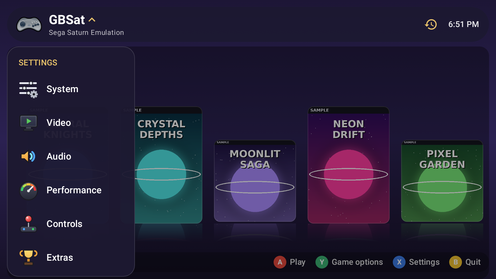
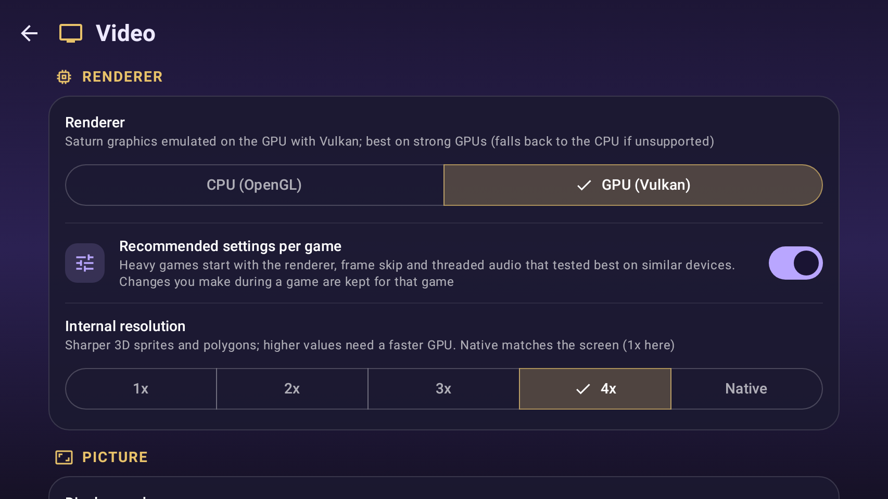
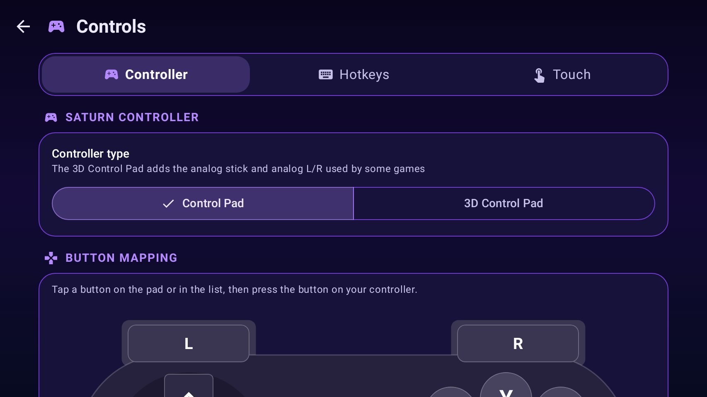
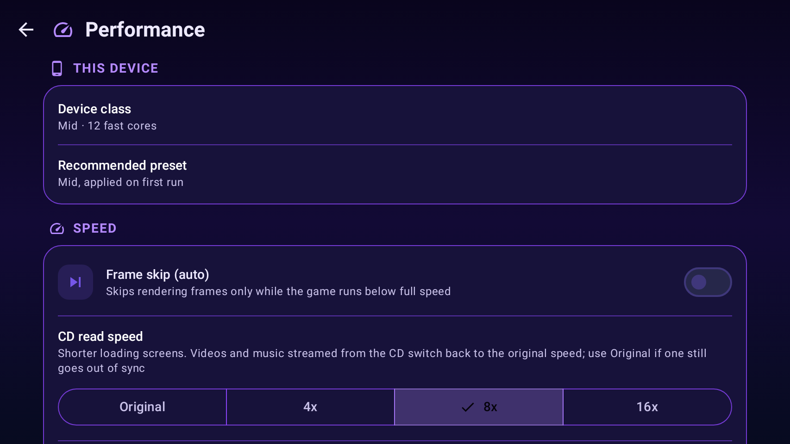
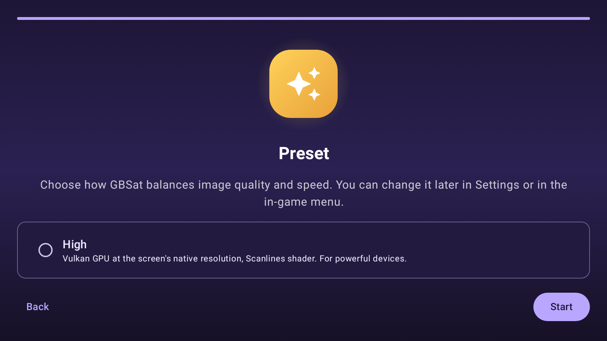
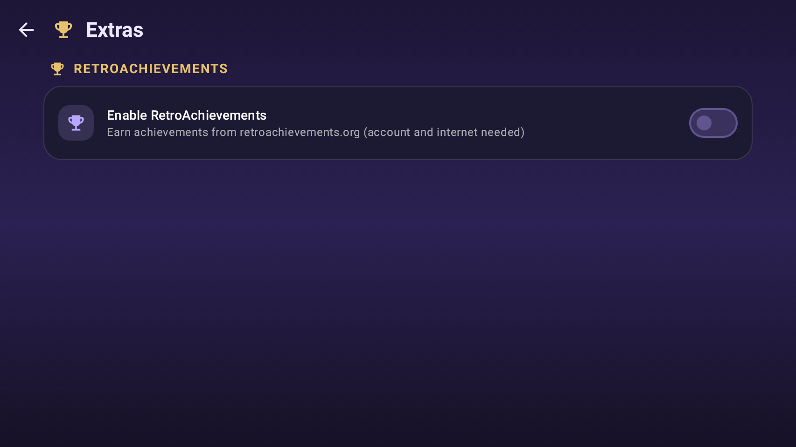

# GBSat

**Sega Saturn emulation for Android phones and handhelds**

Vulkan GPU rendering up to 4x · Full controller navigation · Save states · RetroAchievements

[Download the latest APK](../../releases/latest) · [Changelog](CHANGELOG.md)

## Highlights

| | |
| --- | --- |
| 🚀 **Vulkan GPU renderer** | Saturn VDP1/VDP2 graphics on the GPU with Vulkan compute shaders, internal resolution up to **4x**. CPU (OpenGL) renderer for every other device. |
| 🎮 **Built for handhelds** | The whole app works with a controller: D-pad, A/B/X/Y, Select for recent games, full remapping, hotkeys and an analog 3D Control Pad mode. Touch controls too. |
| 💾 **Save states** | Slots with screenshot previews, quick save/load, **auto save and auto load**, and a "Recent" view to jump straight back into any state. |
| 🏆 **RetroAchievements** | Login, hardcore mode, unlock notifications, achievement list and offline play in casual mode. |
| 🖼️ **Game library** | Box art downloaded automatically (with fuzzy title matching), custom covers, play time per game. |
| 📺 **Display** | 4:3, Fullscreen or 16:9 with **built-in widescreen hacks** for ~20 games; CRT, Dots, LCD3x and Scanlines shaders. |
| ⚡ **Quick presets** | High / Mid / Low tune the renderer, resolution, shader and frame skip in one tap. |

## Screenshots

<table>
<tr>
<td> Settings menu with controller navigation</td>
<td> Video: presets, Vulkan GPU, resolution, shaders</td>
</tr>
<tr>
<td> Button mapping on a Saturn pad diagram</td>
<td> Performance: frame skip, CD speed, emulation options</td>
</tr>
<tr>
<td> First-run setup wizard</td>
<td> RetroAchievements</td>
</tr>
</table>

Screenshots show fictional sample games with original covers drawn for GBSat (`tools/make_sample_covers.py`). They are rendered from the app's UI code by
`ReadmeScreenshots.kt` (workflow "README screenshots").

## All features

**Emulation and video**
- Renderers: CPU (OpenGL ES presentation) and GPU (Vulkan compute shaders, 1x–4x internal resolution)
- Filters (Nearest, Bilinear) and shaders (CRT, Dots, LCD3x, Scanlines)
- 4:3, Fullscreen and 16:9 display modes; widescreen hacks applied automatically
- Automatic frame skip (only while below full speed), threaded audio Auto/On/Off (Auto measures and remembers the faster mode per game), CD read speed up to 16x, fast boot (skips the BIOS setup screens), 4 MiB RAM cartridge, NTSC/PAL
- Overlays: FPS, speed, renderer, resolution, on-screen fast-forward button

**Audio**
- Low-latency AAudio output, volume control, fast-forward audio (Default, Speed up, Mute)

**Games and saves**
- CUE/BIN, CHD, ISO, MDS and CCD images
- Save states with slots and previews, quick slot, auto save/load, recent states view
- Built-in cheat database (libretro-database), Action Replay and raw codes, `.cht` import
- Game options: Continue from the latest state, Open fresh, choose a custom cover
- Recommended per-game settings for slower devices; renderer, frame skip and threaded audio changed in a game are remembered for that game

**Controls and interface**
- Home screen layouts (Settings → Extras → Layout): Showcase (default), Grid and All in One; main menu panel with the library view and the settings
- Controller navigation everywhere, including the in-game quick menu (save/load, video, audio, overlays, cheats, disc tray, reset)
- Button remapping (including L3/R3), hotkeys for quick save/load, fast-forward (hold or toggle) and the menu
- First-run setup wizard, configurable data folder, crash reports with automatic fallback to the CPU renderer

## Requirements

- Android 9 or newer, 64-bit ARM (arm64-v8a). Vulkan GPU renderer: a Vulkan 1.1 GPU (Adreno, Mali, Xclipse…)
- Your own Sega Saturn BIOS image (512 KiB). **None is included.**
- Your own game disc images. **No games are included or downloaded.**

## Getting started

1. Install the APK from the [Releases](../../releases/latest) page.
2. Follow the setup wizard: select your BIOS, pick your games folder and a preset. No storage permission is needed: GBSat only reads the folder you pick.
3. Choose a game in the library. In game, Back (or the on-screen menu button) opens the quick menu.

## Downloads and versions

A release (`GBSat-v<version>.apk`) is published automatically when the version in `apps/android/VERSION` changes; its
notes come from [CHANGELOG.md](CHANGELOG.md). Development builds of every push are in the **Actions** tab (artifact
`GBSat-v<version>-build<N>`). All APKs are signed with the same key, so updates install over each other.

## Building

| Path | Contents |
| --- | --- |
| `apps/android` | Android app: Kotlin/Compose UI and the JNI bridge |
| `libs/gbsat-core` | Emulator core, including the Vulkan compute renderer |
| `vendor/` | Third-party libraries (git submodules) |
| `libs/gbframe` | Shared framework ([GBFrame](https://github.com/mindspot7/GBFrame), git submodule) |
| `apps/vk-test` | Host test comparing the software and Vulkan renderers |
| `.github/workflows` | APK build, Vulkan shader/renderer checks |

Local build: Android Studio with SDK 36, NDK 27.2.12479018 and CMake 3.31.6, plus the DirectX Shader Compiler
(`dxc`, with SPIR-V support) in your `PATH`. Clone with `--recurse-submodules`, open `apps/android` and build.

## Privacy

GBSat collects no personal data; see the [privacy policy](PRIVACY.md).

## License

GBSat is based on [Ymir](https://github.com/StrikerX3/Ymir) by StrikerX3.
Sega Saturn is a trademark of SEGA. GBSat is not affiliated with or endorsed by SEGA.

Widescreen codes: SegaXtreme "Saturn Widescreen Codes & Patches" collection. Cheat database: libretro-database (CC BY-SA 4.0).

GPLv3. See [LICENSE](LICENSE) for the full text and the credits of the original authors.
